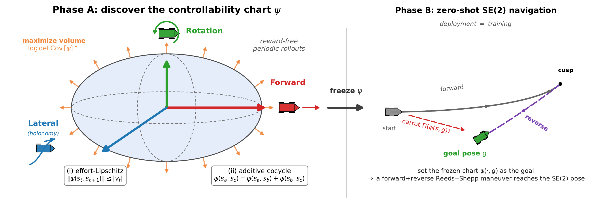
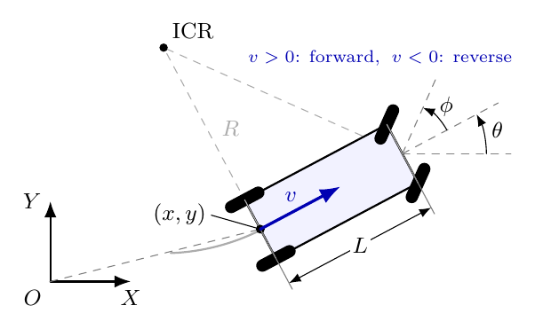
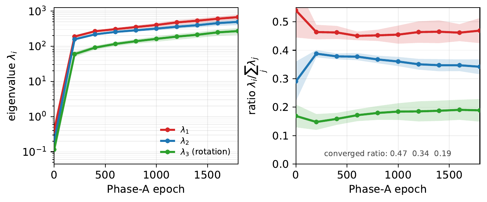
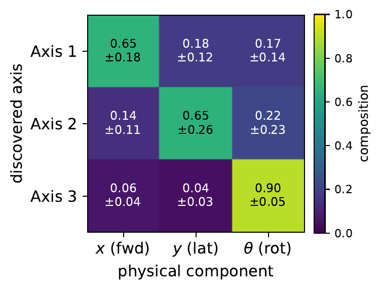
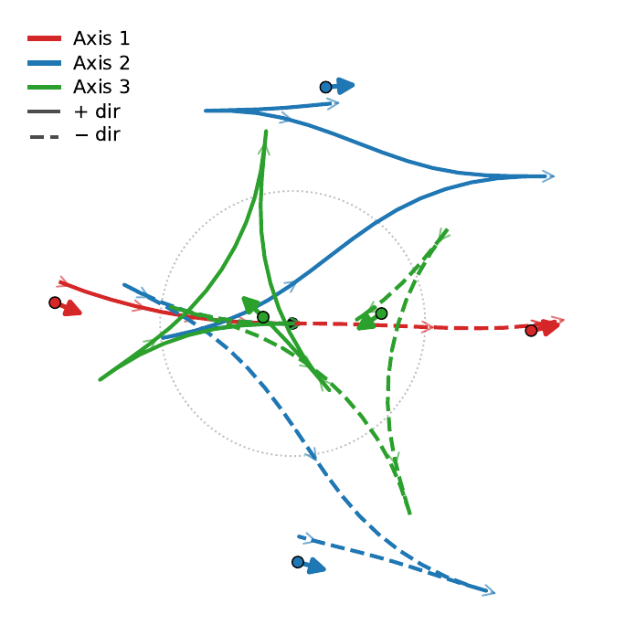
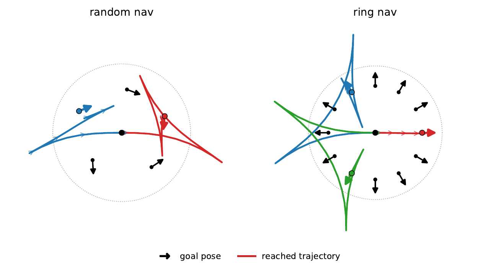
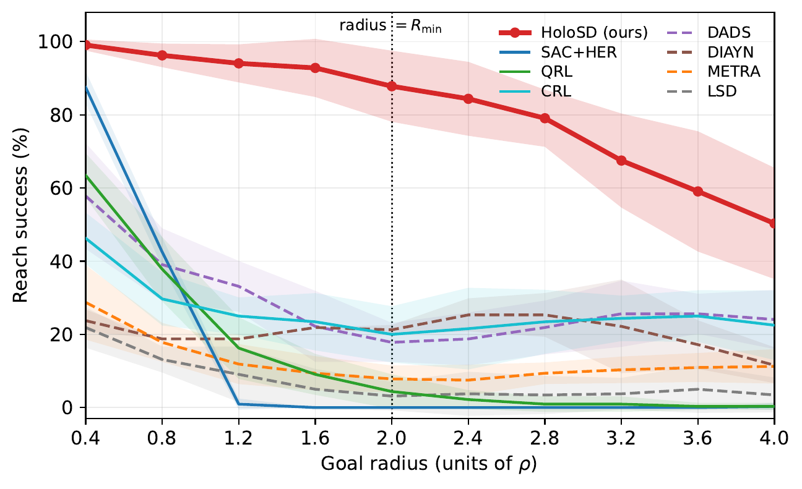

# HoloSD

**Holonomy-Aware Skill Discovery for SE(2) Locomotion of Nonholonomic Agents**
Gyeongrak Choe · Seoul National University

<p align="center">
  
</p>

> **TL;DR.** A car-like (Reeds–Shepp) robot cannot translate sideways with any single
> action — lateral motion only appears as the *geometric phase (holonomy)* of a periodic
> drive-and-steer loop. Distance-maximizing skill discovery erases exactly these modes.
> **HoloSD** instead learns the robot's **controllability geometry** *reward-free* as a
> maximum-volume, effort-constrained **chart**, then drives that chart to reach full
> **SE(2)** goal poses **zero-shot** — ~**97%** position and ~**88%** pose, where prior
> skill-discovery methods reach position but almost never the heading.

---

## Summary

### Why distance-based skill discovery fails here

<p align="center">
  
</p>

State `s = [x, y, θ, φ]` (position, heading, steering angle), control
`a = [v, φ̇]`, minimum turning radius `R_min = 1`. The system is **nonholonomic**: no
action moves the body sideways. Methods that maximize *traveled distance* in a learned
latent (LSD, METRA, …) reward whichever skill ends up farthest, so straight driving
dominates and the bounded lateral / rotation modes are compressed away. Worse, the true
reachability metric is sub-Riemannian (Heisenberg-type) and admits **no** bi-Lipschitz
Euclidean embedding — so a distance latent *structurally* cannot represent the holonomy.

### Method: two phases

HoloSD separates a system's **geometry** (which motions are easy/hard) from its
**control** (how to command them) — see the teaser above.

- **Phase A — learn the controllability chart (reward-free).** Roll out the car under
  random **oscillator-bank** actions (the natural drive-and-steer loops) and learn a
  two-point displacement map `ψ(s, s′)` that **maximizes covariance volume**
  `log det Cov[ψ]` subject to (i) an **effort-Lipschitz** cap `‖ψ(sₜ,sₜ₊₁)‖ ≤ |vₜ|`
  (distance measured in control *effort*, not time) and (ii) an **additive cocycle**
  `ψ(s_a,s_c) = ψ(s_a,s_b) + ψ(s_b,s_c)`. Volume keeps every axis alive; effort surfaces
  the holonomy; the cocycle makes `ψ` a coboundary, so *deployment = training*.

- **Phase B — control on the chart.** Freeze `ψ`. A skill-conditioned SAC policy reaches a
  relative goal pose by (1) driving **position** with a unit-ball-clipped *carrot*
  `Π(ψ(sₜ, g))` and (2) commanding **heading** on a *separate, unnormalized raw channel*
  (so heading isn't buried under the position axes). A telescoping potential reward
  couples the two.

### What the chart discovers — reward-free

<p align="center">
  
</p>

With no reward and no policy, a structured 3-mode ellipsoid emerges: the covariance
eigenvalues grow ~3 orders of magnitude and their ratio converges to a stable anisotropy
**≈ [0.47, 0.34, 0.19]** (effective rank ≈ 2.67). Reading each principal axis through the
chart-to-pose map shows a near-diagonal composition — **Axis 1 = forward (x)**,
**Axis 2 = lateral (y)**, **Axis 3 = in-place rotation (θ, ~0.90 heading content)**:

<p align="center">
  
  
</p>

The lateral axis is realized as a **parallel-parking arc** (the Lie-bracket holonomy no
single action can produce) — *discovered* by the geometry, not engineered by a drift reward.

### Results — full-SE(2) zero-shot navigation

<p align="center">
  
</p>

Goal navigation on the Reeds–Shepp car (`R_min = 1`). **Reach** = position within `0.2ρ`;
**Pose** = reach *and* heading error `< 0.3 rad`. Success rate (%, mean over 10 seeds):

| Method | Family | Random&nbsp;Reach | Random&nbsp;Pose | Ring&nbsp;Reach | Ring&nbsp;Pose |
|---|---|:--:|:--:|:--:|:--:|
| SAC+HER | goal-cond. | 80.2 | 48.8 | 82.5 | 74.2 |
| QRL | goal-cond. | 64.8 | 36.9 | 40.8 | 29.2 |
| CRL | goal-cond. | 60.2 | 30.0 | 40.8 | 28.3 |
| DADS | skill disc. | 66.2 | 5.6 | 33.3 | 8.3 |
| DIAYN | skill disc. | 47.9 | 4.2 | 16.7 | 8.3 |
| METRA | skill disc. | 45.8 | 3.3 | 20.8 | 4.2 |
| LSD | skill disc. | 37.5 | 6.5 | 22.5 | 12.5 |
| **HoloSD (ours)** | skill disc. | **96.7** | **88.1** | **98.3** | **95.0** |

Skill-discovery baselines reach *where* to go but not the SE(2) *heading* (pose ≤ 6.5%);
goal-conditioned methods get heading but collapse past `R_min`. HoloSD fills the empty
"skill discovery **and** reaches SE(2) heading" cell, and is the only method whose reach
stays flat with goal distance:

<p align="center">
  
</p>

> Figures are reproduced from the paper (`asset/`). See the paper for full derivations,
> hyperparameters, and component ablations.

---

## Code

All-JAX (Flax/Optax) implementation on a kinematic Reeds–Shepp car. The shipped algorithm
is **self-contained** in a single module.

### Layout

```
holosd/
  models.py                 Flax building blocks: MLP, Encoder, Actor, DoubleCritic, period embed
  bicycle/
    env.py                  Reeds–Shepp car: exact-arc dynamics, obs, phase clock, rollout, render
    chart.py                two-point displacement-chart helpers (angle wrap, coords, distances)
    holosd_final.py         ★ the algorithm — Phase A chart ψ + Phase B SAC; `train` / `eval` CLI
    eval_plots.py           paper-style eval figures + nav videos from a checkpoint
scripts/
  holosd_seed_sweep.sh      10-seed sweep across GPUs -> per-seed ckpt + metrics
  agg_holosd.py             aggregate the 10-seed metrics -> mean ± std
asset/                      figures used in the paper / this README
```

`holosd_final.py` maps directly onto the paper: `Psi` (the chart `ψ`), `OscActor`/`build_mu`
(reward-free oscillator-bank data), `build_geom_train` + `compute_eig` (Phase A volume /
effort-Lipschitz / cocycle objective and the controllability ellipsoid), and
`build_control` + `build_update` + `carrot` (Phase B SAC with the raw-heading channel).

### Setup

Needs an NVIDIA GPU with a **CUDA-12-capable driver** (JAX ships the CUDA runtime via pip —
no system CUDA install needed) and [`uv`](https://docs.astral.sh/uv/).

```bash
uv sync          # creates .venv from uv.lock (py3.10, jax-cuda12, flax, optax, ...)
```

### Usage

```bash
# --- train (Phase A 1800 ep + Phase B 3000 ep; GPU index via HOLOSD_GPU) ---
JAX_PLATFORMS=cuda HOLOSD_GPU=0 \
  uv run python -m holosd.bicycle.holosd_final train --out_dir exp/bicycle/HoloSD --seed 0
# -> exp/bicycle/HoloSD/{ckpt_final.pkl, train_log.jsonl}
# (add --quick for a fast smoke run)

# --- evaluate a checkpoint: goal-nav metrics (CPU, fast) ---
JAX_PLATFORMS=cpu uv run python -m holosd.bicycle.holosd_final eval \
  exp/bicycle/HoloSD/ckpt_final.pkl

# --- paper-style figures + nav videos for a checkpoint (-> <ckpt_dir>/eval/) ---
JAX_PLATFORMS=cpu uv run python -m holosd.bicycle.eval_plots \
  exp/bicycle/HoloSD/ckpt_final.pkl        # add --no_video to skip the mp4 grids
```

10-seed reproduction (edit GPU list inside the script for your machine):

```bash
bash scripts/holosd_seed_sweep.sh          # trains s0..s9 -> exp/bicycle/HoloSD/seeds/
uv run python scripts/agg_holosd.py        # -> mean ± std headline numbers
```

Key settings (full table in the paper): `Δt=0.1`, `v_max=1.0`, wheelbase `L=0.5`,
`φ_max=arctan 0.5`, `φ̇_max=1.5` (⇒ `R_min=1`), episode `T=200` train / `300` eval,
chart dim `d=3`, `ρ=0.5`.

---

## Citation

```bibtex
@misc{choe2025holosd,
  title  = {HoloSD: Holonomy-Aware Skill Discovery for SE(2) Locomotion of Nonholonomic Agents},
  author = {Choe, Gyeongrak},
  year   = {2025}
}
```

Phase A borrows the oscillator-bank periodic exploration of Periodic Skill Discovery (PSD);
thanks to Jonghae Park (PSD) and Prof. H. Jin Kim.
